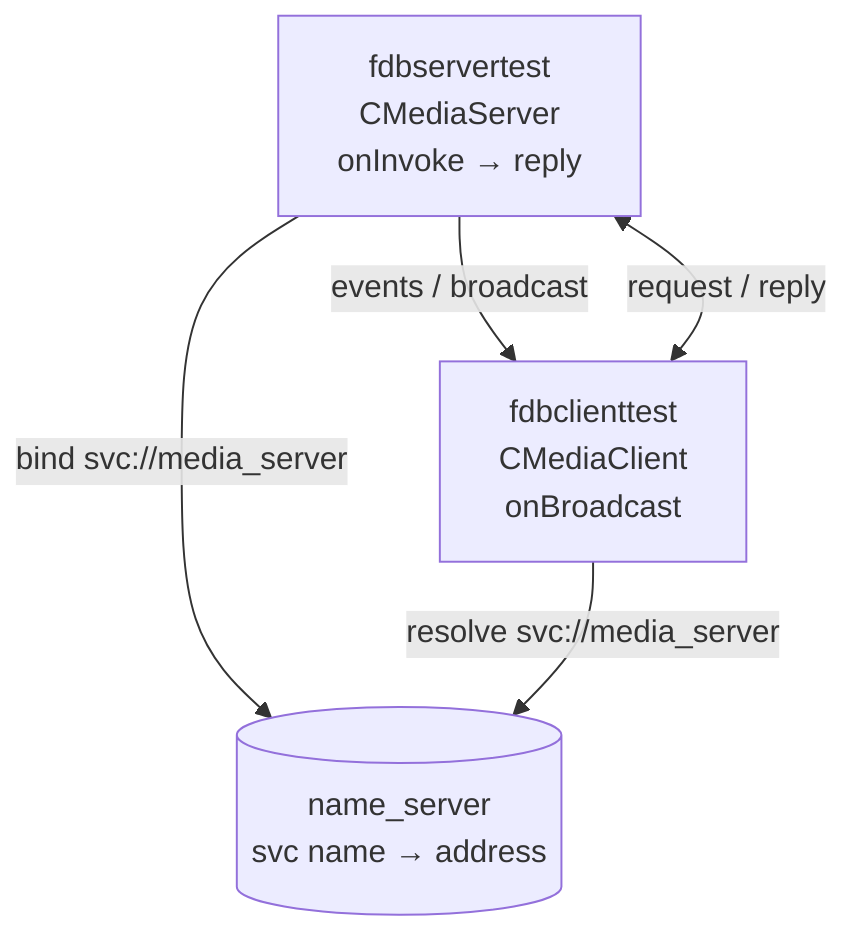

# FDBus Client–Server Communication Example

This repository demonstrates **how a client and a server communicate over
[FDBus](https://gitee.com/jeremyczhen/fdbus)**, a high-performance IPC/RPC
framework. A server registers a named service, clients connect to
`svc://<service-name>`, and the two sides exchange **requests, replies, and
events** — all over FDBus.

It contains the FDBus library sources and CMake build scripts needed to build
and run the example from a fresh checkout.

## What the example demonstrates

- **Named service discovery** — the server binds `svc://media_server`; the
  client resolves the same name through the FDBus name server.
- **Synchronous request/reply** — `invoke()` blocks until the server calls
  `reply()` (protobuf payload).
- **Asynchronous request/reply** — `invoke()` returns immediately and the reply
  arrives in `onReply()`.
- **Raw and parcelable payloads** — a raw buffer request plus
  `CFdbParcelableBuilder` for structured C++ data.
- **Publish/subscribe events** — the server broadcasts protobuf, raw-buffer,
  cJSON, and grouped events; the client subscribes with filters.
- **Connection lifecycle** — `onOnline()` / `onOffline()` on both sides,
  automatic reconnect, UDP transport, and timestamps.
- **Server watchdog** and per-request latency metadata
  (client→server, arrive→reply, reply→client).

## How the communication flows



The server (`example/client-server/fdb_test_server.cpp`) handles `onInvoke()`
by decoding the client's message and replying, and broadcasts events every
1.5 seconds. The client (`example/client-server/fdb_test_client.cpp`) connects,
subscribes to events, and invokes the server every 10 seconds.

## Repository layout

```
example/client-server/fdb_test_server.cpp   Server: binds service, handles
                                            invoke(), broadcasts events
example/client-server/fdb_test_client.cpp   Client: connects, invokes,
                                            subscribes to events
example/CFdbIfPerson.h                      Person/Car structures used by the
                                            parcelable payload test
example/idl/common.base.Example.proto       Protobuf messages: SongId,
                                            NowPlayingDetails, ElapseTime
fdbus/ platform/ utils/ worker/ log/        FDBus library implementation
security/ server/ public/ c/                 (services, headers, C bindings)
cmake/                                      Library build
cmake/pb-example/                           Example build
```

## Prerequisites

- Linux with a C++11 compiler
- CMake
- Protocol Buffers compiler and development libraries (`protoc`, `libprotobuf-dev`)
- pthread

On Debian/Ubuntu:

```bash
sudo apt install build-essential cmake protobuf-compiler libprotobuf-dev
```

## Build

The build has two stages: first the FDBus library, then the example.

```bash
# 1. Build and install the FDBus library into .dist/
cmake -S cmake -B build-linux \
      -DCMAKE_BUILD_TYPE=Debug \
      -DCMAKE_INSTALL_PREFIX="$PWD/.dist"
cmake --build build-linux -j"$(nproc)"
cmake --install build-linux

# 2. Build the example against the installed library
cmake -S cmake/pb-example -B build-example \
      -DCMAKE_BUILD_TYPE=Debug \
      -DCMAKE_INSTALL_PREFIX="$PWD/.dist" \
      -DSYSTEM_ROOT="$PWD/.dist"
cmake --build build-example -j"$(nproc)"
```

This produces:

| Binary | Purpose |
| --- | --- |
| `build-example/fdbservertest` | Client/server example — server |
| `build-example/fdbclienttest` | Client/server example — client |
| `.dist/usr/bin/name_server` | FDBus name server (service name resolution) |

## Run

Start the name server first, then the server and client. The service name
passed to both programs must match.

```bash
# Terminal 1: name server
./.dist/usr/bin/name_server

# Terminal 2: server
./build-example/fdbservertest media_server

# Terminal 3: client
./build-example/fdbclienttest media_server
```

The client reconnects automatically, so it may also be started before the
server. Expected behaviour:

- The client invokes `REQ_METADATA` (protobuf reply) and `REQ_RAWDATA`
  (raw/parcelable reply), printing the response and latency metadata.
- The server broadcasts an elapsed-time event, a raw buffer, a cJSON object,
  and grouped events every 1.5 seconds.
- The client prints the replies and every received event.

## Core API at a glance

**Server** — bind a service, handle requests, broadcast events:

```cpp
auto server = new CMediaServer("media_server_server");
server->enableWatchdog(true);
server->bind("svc://media_server");

void onInvoke(CBaseJob::Ptr &msg_ref) {
    auto msg = castToMessage<CBaseMessage *>(msg_ref);
    // decode request, then reply
    msg->reply(msg_ref, builder);
}

broadcast(NTF_ELAPSE_TIME, builder, "my_filter");
```

**Client** — connect to the service, invoke it, subscribe to events:

```cpp
auto client = new CMediaClient("media_server_client");
client->enableReconnect(true);
client->connect("svc://media_server");

CBaseJob::Ptr ref(new CBaseMessage(REQ_METADATA));
invoke(ref, builder);            // synchronous; server calls reply()

CFdbMsgSubscribeList list;
addNotifyItem(list, NTF_ELAPSE_TIME, "my_filter");
subscribe(list);                 // events arrive in onBroadcast()
```

## Notes

- Only the sources needed to build the client-server example are tracked; see
  `.gitignore` for excluded build output and unrelated files.
- Upstream FDBus has moved from GitHub to
  <https://gitee.com/jeremyczhen/fdbus>.
